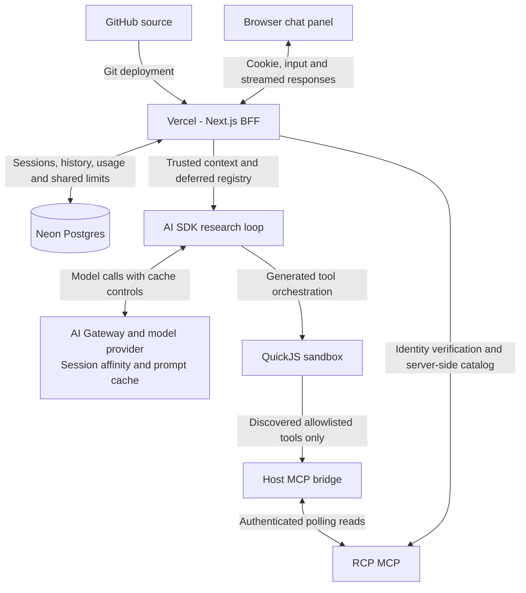
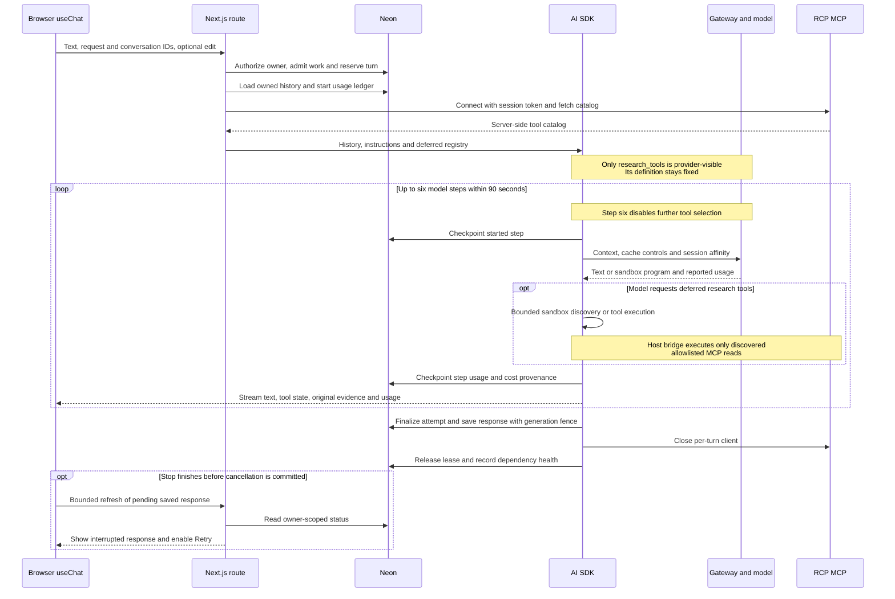
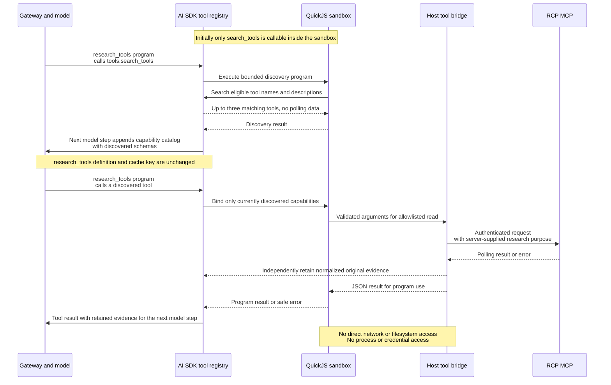
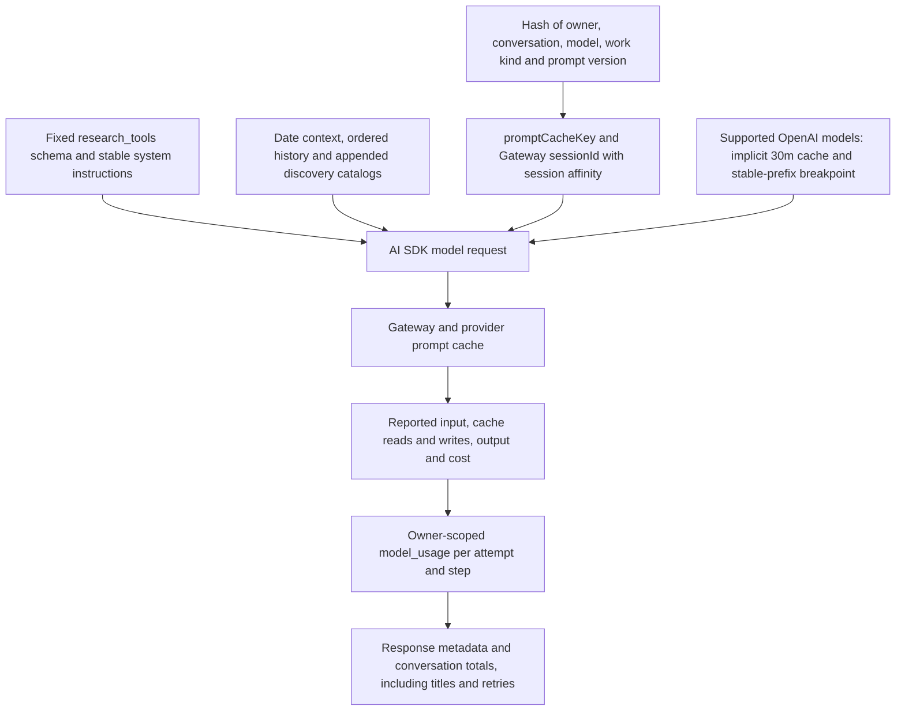

# RealClear conversational polling

A staging demo for exploring polling data through sourced, multi-turn conversations. Built with Next.js, React, Vercel AI SDK, Vercel AI Gateway and Neon Postgres. Users sign in with an existing RCP MCP token; answers use real read-only MCP tools, with saved conversations, evidence drawers, tables and charts.

The RCP + AI launcher opens a resizable chat panel over a labeled landing-page mock. An optional iframe loads the RealClearPolling website; the mock remains available when embedding fails. The backdrop supplies neither credentials nor page context to the agent.

## Delivery summary

- **Conversational research:** real MCP-backed polling retrieval, multi-turn follow-ups, source links and dates, clarification guidance, and explicit missing-data/tool-failure handling.
- **Account continuity:** existing RCP-token sign-in, encrypted server-side credentials, cookie sessions and account-owned conversations across sign-ins and token changes.
- **Chat UX:** streaming answers, waiting states, Enter/Shift+Enter controls, edit-last-message, Stop/Retry, local drafts, recent and pinned chats, editable/generated titles, and preserved history-panel state.
- **Evidence presentation:** collapsed MCP drawers, tables and interactive time-series charts with observation values, percentage-point changes, candidate leads and declared-party colors. Missing values remain gaps.
- **Agent execution:** native AI SDK deferred tool search, sandboxed QuickJS tool orchestration, bounded work, prompt-cache controls, per-response metadata and conversation-wide token/cost totals.
- **Operational safeguards:** shared Postgres rate limits and circuit breakers, per-account throttling, generation fencing and recoverable interrupted responses.

The latest local production-build verification passed **72 unit/integration tests and all three Google Chrome E2E scenarios**, including live MCP/Gateway research. Formatting, zero-warning lint, type checking and the production build passed. Axe reported no accessibility violations on the scanned sign-in and chat screens; the browser runs reported no JavaScript exceptions. These results establish tested local behavior, not hosted availability or production capacity.

This repository is a staging demonstration, not a production-ready product. The limits and next steps below distinguish implemented behavior from proposed extensions.

## Contents

- [Components and services](#components-and-services)
- [Run locally](#run-locally) and [deployments](#deployments-and-migrations)
- [Architecture](#architecture), [authentication](#authentication-and-user-identity) and [database protection](#database-structure-and-conversation-protection)
- [One agent turn](#one-agent-turn), [prompt caching and usage](#prompt-caching-and-usage-accounting)
- [Shared reliability limits](#shared-reliability-and-abuse-limits) and [context/memory extensions](#conversation-context-and-user-memory)
- [Verification](#verification-and-operations), [Chrome automation](#chrome-ux-automation) and [current limits](#current-limits)

## Components and services

| Component         | Responsibility                                                                                 | Location                                                                                                                                    |
| ----------------- | ---------------------------------------------------------------------------------------------- | ------------------------------------------------------------------------------------------------------------------------------------------- |
| GitHub            | Source, dependency pins, SQL migrations and tests                                              | [alexlopashev/tz-chat](https://github.com/alexlopashev/tz-chat)                                                                             |
| Vercel            | Next.js UI, backend routes, streaming responses and Git deployments                            | [Project](https://vercel.com/alexlopashev-gmailcoms-projects/tz-chat) · [Demo](https://tz-chat-alexlopashev-gmailcoms-projects.vercel.app/) |
| Neon              | Accounts, encrypted credentials, browser sessions, conversations and shared request protection | [Postgres project](https://console.neon.tech/app/projects/fancy-base-03274879)                                                              |
| RCP MCP           | Verifies an existing RCP identity and supplies polling data through the user's token           | `https://rcp.tazalabs.ai/mcp`                                                                                                               |
| Vercel AI Gateway | Authenticated model access for research and title generation                                   | [`src/lib/gateway.ts`](src/lib/gateway.ts)                                                                                                  |
| Vercel AI SDK     | Browser streaming state, server model/tool loop and structured message parts                   | [`src/lib/agent`](src/lib/agent)                                                                                                            |

## Run locally

Install [mise](https://mise.jdx.dev/getting-started.html), then:

```sh
mise trust
mise install
mise run install
cp .env.example .env.local # only if .env.local does not already exist
# Fill in the server-side settings below.
mise run db:migrate      # verify the target database before running
mise run dev
```

The app runs at `http://localhost:3000`. Open RCP + AI and paste a valid RCP token; an optional `Bearer ` prefix is accepted. No application-wide `RCP_MCP_TOKEN` variable is used.

`mise.toml` pins Node 24.22.1 and npm 12.2.1; application dependencies are pinned in `package.json` and `package-lock.json`.

| Variable                   | Purpose                                                                                            |
| -------------------------- | -------------------------------------------------------------------------------------------------- |
| `DATABASE_URL`             | Neon TLS connection for the intended environment, normally pooled                                  |
| `DATABASE_MIGRATION_URL`   | Optional direct connection for explicit migrations; falls back to `DATABASE_URL`                   |
| `RCP_TOKEN_ENCRYPTION_KEY` | 32 random bytes encoded as 64 hex characters; encrypts stored MCP tokens                           |
| `AI_GATEWAY_MODEL`         | Research model ID; `.env.example` uses `openai/gpt-6.1-sol`                                        |
| `AI_GATEWAY_API_KEY`       | Gateway authentication for local execution; supported Vercel OIDC can supply hosted authentication |
| `RCP_MCP_URL`              | RCP endpoint above; the application validates this exact endpoint                                  |
| `APP_ORIGIN`               | Optional strict origin override for a custom proxy; otherwise derived from the request host        |

Set secrets through Vercel's environment settings for each environment. Keep the encryption key stable within an environment and consistent across its instances; use different keys for isolated environments. Rotating it requires re-encrypting stored credentials or reconnecting affected users. Never commit `.env.local` or expose credentials through `NEXT_PUBLIC_` variables. Environments requiring Node's HTTP proxy support may need `NODE_USE_ENV_PROXY=1`; this is not an application credential.

## Deployments and migrations

Vercel's native GitHub integration deploys `main` to production and branches/PRs to previews. `vercel.json` delegates installation/builds to `scripts/vercel.mjs`; deployment gates run formatting, lint, type checking, tests and a Next.js production build. No separate GitHub Actions deployment workflow is needed. Branch protection is a separate GitHub setting.

| Environment | Neon branch                               | Configuration                                     |
| ----------- | ----------------------------------------- | ------------------------------------------------- |
| Production  | `production` · `br-red-cherry-b7aqykv9`   | Production-scoped database URL and encryption key |
| Preview     | `preview` · `br-lucky-cake-b70179mt`      | Preview-scoped database URL and encryption key    |
| Development | Preview or a dedicated development branch | Local settings for the chosen branch              |

The Neon project is `fancy-base-03274879`, database `tz_chat`, PostgreSQL 17 in AWS Northern Virginia. Environment separation depends on the configured database URL; a Vercel preview does not automatically create its own Neon branch. Do not share production credentials with untrusted previews.

Migrations in [`db/migrations`](db/migrations) run explicitly with `mise run db:migrate`, never during deployment builds. The runner uses a transaction, advisory lock and checksum ledger. Apply all migrations, currently through `0006_model_usage`, before serving this version. Add new versioned migrations instead of modifying applied files.

## Architecture

The Next.js backend is the application's origin and backend-for-frontend. It authenticates requests, owns persistence and invokes external services. The browser receives streamed answers and safe evidence, never the stored MCP credential. GitHub contains the implementation; Vercel runs it; Neon supplies shared durable state.



### Component boundaries

| Component          | Role                                                                                                        | Implementation                                                                                       |
| ------------------ | ----------------------------------------------------------------------------------------------------------- | ---------------------------------------------------------------------------------------------------- |
| Browser UI         | Sign-in, chat/history, drafts, waiting states, Stop/Retry, collapsed MCP drawers and evidence-driven charts | [`src/components`](src/components)                                                                   |
| Next.js routes     | Same-origin write checks, session authorization, input validation, admission and streaming lifecycle        | [`src/app/api`](src/app/api)                                                                         |
| Authentication     | Verified RCP identity, encrypted credentials and opaque browser sessions                                    | [`src/lib/auth`](src/lib/auth)                                                                       |
| Repository         | Owner-scoped SQL, ordered history, atomic turn reservation and completion fencing                           | [`src/lib/repository.ts`](src/lib/repository.ts)                                                     |
| Shared protection  | Distributed quotas, expiring work leases and dependency circuit breakers                                    | [`src/lib/protection.ts`](src/lib/protection.ts), migration `0005`                                   |
| Agent              | Prompt/context conversion, bounded model/tool loop and response persistence callbacks                       | [`src/lib/agent`](src/lib/agent)                                                                     |
| Service transports | Neon HTTP queries, Gateway model selection and authenticated MCP connections                                | [`database.ts`](src/lib/database.ts), [`gateway.ts`](src/lib/gateway.ts), [`mcp.ts`](src/lib/mcp.ts) |

Next.js route handlers run server-side; there is no separate long-running agent server. Database operations have independent 15-second timeouts. A model call, MCP connection and browser authentication session have different lifetimes.

## Authentication and user identity

1. The user pastes an existing RCP MCP token. The backend normalizes an optional `Bearer ` prefix and connects to the allowlisted MCP endpoint.
2. The backend calls `whoami` and validates the returned `account_id` UUID. It does not decode the token to infer identity or accept a user ID from the browser.
3. That account ID becomes the stable application owner. Different valid RCP tokens for the same account access the same history.
4. The backend encrypts the token with AES-256-GCM using `RCP_TOKEN_ENCRYPTION_KEY`. A random nonce is generated for each ciphertext, and the account ID is authenticated as associated data.
5. The backend creates a random 256-bit session ID, stores its SHA-256 hash and returns the original ID only in a cookie. The session links to the encrypted credential and verified account.

The cookie is HttpOnly, SameSite=Lax and host-only; HTTPS adds Secure and the `__Host-` prefix. Sessions expire after 30 days without silent renewal. Logout revokes the current session; signing in again replaces that browser's prior session. JWT access/refresh tokens are not used.

For each authenticated request, the backend checks session expiry/revocation and obtains the account ID from the database. MCP calls decrypt the credential associated with that current session, rather than retaining an older chat's token. Cookie-authenticated writes check Origin against the trusted host or configured `APP_ORIGIN`.

RCP token revocation is not pushed into the app: the browser session can remain valid while subsequent MCP calls reject its credential. Already saved evidence remains account-owned history. Expired sessions and credential rows are retained until explicitly maintained; automatic retention and account-wide session management are not implemented.

## Database structure and conversation protection

| Table               | Stored state and relationships                                                                                                                                 |
| ------------------- | -------------------------------------------------------------------------------------------------------------------------------------------------------------- |
| `app_users`         | Stable verified RCP account ID and sign-in timestamps                                                                                                          |
| `rcp_credentials`   | Encrypted token per sign-in, linked to `app_users`                                                                                                             |
| `user_sessions`     | Hashed session ID, owner, credential, expiry and revocation; composite foreign key binds the credential to the same owner                                      |
| `conversations`     | UUID, owner ID, title, title source/revision, pin and timestamps                                                                                               |
| `messages`          | Conversation and owner, sequence, request ID, role, rich SDK parts, status, generation ID and start time                                                       |
| `datasets`          | Reserved snapshot schema; currently unused by the agent. Actual evidence is saved in `messages.parts_json`                                                     |
| `runtime_buckets`   | Shared per-account/global request-window counters                                                                                                              |
| `runtime_leases`    | Active chat/title work with expiry for crash recovery                                                                                                          |
| `runtime_circuits`  | Gateway/MCP failure counts, cooldowns and fenced recovery probes                                                                                               |
| `model_usage`       | Owner-scoped usage ledger per research/title attempt, with per-step token counts, pricing snapshots, cost provenance and status; survives answer edits/retries |
| `schema_migrations` | Applied versions and content checksums                                                                                                                         |

Conversation ownership is enforced by authenticated, owner-scoped repository queries. Composite foreign keys prevent messages/datasets from claiming a different owner than their parent conversation. `conversations.owner_id` holds the verified account ID; it is not itself a foreign key to `app_users`. There is no database row-level-security policy: authorization depends on the backend query boundary and constraints. Application-level encryption covers MCP credentials; chat text and evidence are ordinary database records protected by access control, not individually encrypted by this application.

A short transaction locks the conversation row before reserving a user/assistant pair. Unique `(conversation_id, sequence)` and `(conversation_id, request_id, role)` constraints prevent duplicate ordering and duplicate turns. A partial unique index allows one pending assistant per conversation. Retries retain the logical request ID but get a new generation ID; completion updates only the matching pending generation, so late results cannot overwrite a newer attempt.

Editing the latest question checks its previous request ID, replaces that turn and reserves a new generation atomically. Older turns remain intact. There is no immutable edit history. Pending attempts older than two minutes become retryable as interrupted. These mechanisms prevent conflicting writes; they do not resume an interrupted model execution.

User questions are persisted before generation. Assistant text, tool inputs/results and sources are saved together as SDK message parts at finalization, with `complete`, `failed` or `interrupted` status. Usage is also checkpointed after each completed model step in a separate attempt ledger. A worker killed before finalization may lose streamed partial output and tool results; the ledger retains completed-step measurements, while the interrupted call may have unreported usage. The pending row survives, allowing a later retry.

Unsent drafts live separately in browser local storage, keyed by account and conversation, with a separate new-chat key. Text and valid edit context restore for up to 30 days and clear after server acceptance. Storage failures do not block chat. Drafts are local-device convenience data, not server history, cross-device synchronization or a credential store.

## One agent turn

The lifecycle diagram shows one user turn. The following detail diagram expands the deferred-tool branch inside that loop.



### Deferred discovery and sandbox execution

Search and execution occur on different model steps. Discovery changes the conversation capability catalog, not the provider-visible tool schema. Saved evidence can answer presentation-only follow-ups without entering this branch.



The browser uses AI SDK `useChat` and `DefaultChatTransport`, but sends only the question, identifiers and optional edit metadata. It does not supply trusted conversation history. The route loads history from Neon and includes user turns and complete assistant turns. `convertToModelMessages` converts rich UI parts into model text/tool exchanges and ignores incomplete tool calls. Failed/interrupted assistant content stays visible in the UI but is not replayed to the model; its user question remains in history.

`streamText` receives the research system instructions, reconstructed messages, Gateway model and tool definitions. One user turn can require several LLM requests: a model step requests tools, the SDK executes them, and the next model step receives their results. The sixth step disables further tool selection so the model can conclude with available evidence. Automatic model retries are disabled; a user retry is a new execution attempt.

Each chat request creates a fresh MCP client and fetches its catalog server-side. The provider sees a fixed native AI SDK code-mode tool (`research_tools`, pinned experimental `@ai-sdk/code-mode`). Its `toolDiscovery: "conversation"` capability message initially exposes only native `toolSearch()` (`search_tools`). The eight allowed MCP reads use `deferLoading: true`. Native keyword search over names/descriptions returns at most three matches per search; their schemas are appended as conversation capability messages on the next model step and remain available for the rest of that generation. Discovery resets for each turn, including saved conversations. Presentation-only follow-ups can reuse saved evidence without searching. Search consumes a model step but no MCP lookup; the six-step/90-second bounds still apply. Discovery/execution is displayed separately from MCP evidence. Technical tool-call counts count model-visible sandbox invocations; each can make multiple nested MCP calls.

The deferred catalog is filtered to these eight reads:

`search_races`, `get_race`, `get_race_polls`, `get_race_average_history`, `compare_races`, `list_pollsters`, `get_race_ratings`, `get_rating_changes`.

Code mode executes in isolated QuickJS with no direct network, filesystem, process or module access. Only the allowlisted read tools are bridged in. Each invocation has a 25-second wall deadline, 1-second CPU budget, 16 KB source limit, ten host calls and two concurrent host calls; model-visible sandbox invocations execute one at a time. The existing ten-MCP-call limit spans the entire turn. The server captures normalized evidence separately from generated-code return values so omitting or transforming a result cannot replace chart/table data. Successful evidence is retained even when a later sandbox operation fails.

The server supplies research-purpose fields. `whoami` is used only by sign-in, and feedback/account tools are not exposed to the agent. MCP content is untrusted: results are size-checked, normalized and scrubbed of account/session/token metadata before becoming evidence. Tool failures become explicit errors rather than fabricated polling values. Tables and charts derive their numbers from the saved evidence; Markdown cannot execute HTML or chart code.

| Execution bound                            | Value                                   |
| ------------------------------------------ | --------------------------------------- |
| Overall turn deadline / route maximum      | 90 seconds / 120 seconds                |
| Model steps / output per step              | 6 / 3,000 tokens                        |
| MCP calls / concurrent tool calls          | 10 / 2                                  |
| Tool discovery / individual lookup timeout | 10 seconds / 12 seconds                 |
| Tool result size / historical context size | 120,000 characters / 350,000 characters |

The history limit is character-based, not token-aware summarization. Stop requests cancel the execution; finalization saves available parts when possible. Browser reload does not reconnect to an existing stream. If the saved response is pending without an active browser stream, the UI refreshes its snapshot every two seconds, bounded to 65 attempts, to observe server finalization or the two-minute stale-generation recovery. This also handles Stop completing before the cancellation status is committed; it does not restart agent execution. There is no provider-side conversation ID, durable background queue or reusable cross-turn MCP client.

Chat titles are separate model work. Automatic and manual generation use `generateText` with `openai/gpt-6-luna`, bounded question-only context, a 12-second timeout and 160 output tokens. Title revision checks prevent delayed generation from overwriting a newer manual change. Title generation does not provide memory for the research model.

## Prompt caching and usage accounting



The cache is provider-managed, not a stored agent session. Every step still sends its required context. Cache hits depend on provider matching, routing, minimum sizes and expiry, and are confirmed only by reported usage. Deferred discovery preserves the fixed tool prefix but does not guarantee reuse of the full conversation prefix.

For GPT-6 and supported GPT-5.6+ model IDs, the AI SDK sends `openai.promptCacheOptions: { mode: "implicit", ttl: "30m" }` and `promptCacheKey`; these map to OpenAI's `prompt_cache_options` and `prompt_cache_key`. The stable system-instruction message also carries `promptCacheBreakpoint: { mode: "explicit", ttl: "30m" }`, retaining implicit conversation caching while marking the stable prefix. Older OpenAI model IDs receive a stable key with provider-default retention instead of incompatible modern options. Non-OpenAI models use Gateway automatic caching. Cache policy is configured in [`cache.ts`](src/lib/agent/cache.ts).

The key is a SHA-256 digest of prompt version, verified owner, conversation, model and work kind. It remains stable across turns, retries and sign-ins for that conversation, while research and titles have separate keys. It is also the Gateway `sessionId`, with `sessionAffinity: true` and `caching: "auto"`. The key is a routing/accounting hint, not an authorization mechanism or a provider-side conversation store. OpenAI `store: false` disables stored Responses state; it does not disable prompt caching or replace provider data-retention policies.

Stable instructions come before a separate date-context message. Tool definitions are sorted by name and schema object keys are canonicalized. Native code mode uses conversation-based discovery: the provider-visible tool definition stays identical as tools are found, preserving eligibility for tool-prefix caching. New capability catalogs are appended after existing context; they do not rewrite the fixed system prompt. Actual hit rates remain provider-dependent. Discovery resets on each turn, so this does not promise reuse of the entire prior turn prefix. Saved history is replayed in order without rewriting prior turns; technical usage data is excluded from model context. Every model step still sends the full required context. Cache matching, minimum sizes, expiry and routing determine actual reuse; sending the options does not guarantee a hit.

[OpenAI's caching guide](https://developers.openai.com/api/docs/guides/prompt-caching) describes modern cache controls and [Gateway session affinity](https://vercel.com/docs/ai-gateway/models-and-providers/session-affinity) describes routing. The installed Gateway forwards AI SDK provider options. No direct OpenAI credential is required for this Gateway-based setup.

### Response and conversation metadata

`model_usage` records one row per execution attempt, including title work. The row is created before generation, updated at step start/end, and finalized on completion, error or interruption. Edits/retries create new attempts, so replacing an answer does not erase its historical cost. Queries are owner-scoped and a composite conversation/owner foreign key protects the parent relationship. A pending record older than two minutes is presented as interrupted.

Each assistant response streams a safe usage summary as message metadata and saves a `data-usage` part for reload. It includes model/provider, elapsed time, call counts, cache policy, per-step usage and cost provenance. Raw provider metadata, credentials and request headers are not exposed. The AI SDK excludes this custom data part from model history. The bottom technical drawer totals the conversation across sign-ins, including title generation and superseded attempts; this is not a browser-login-session total.

| Measurement              | Meaning                                                                                                                  |
| ------------------------ | ------------------------------------------------------------------------------------------------------------------------ |
| Input                    | Total input tokens reported by the SDK                                                                                   |
| Uncached input           | Non-cached input; distinct from cache-read/write tokens                                                                  |
| Cache read / cache write | Provider-reported subsets of input, including cache creation when reported                                               |
| Output                   | Total generated tokens, including reasoning; reasoning is also shown separately                                          |
| Gateway-reported cost    | The per-step `providerMetadata.gateway.cost` in USD, preferred when available                                            |
| Estimated cost           | Fallback using complete token categories and matching-model catalog rates captured at execution time; explicitly labeled |
| Missing/partial usage    | Shown as not reported/partial, never assumed to be zero or free                                                          |

Catalog rates come from `getAvailableModels()` and are cached in-process for ten minutes. They are **USD per token**; the UI displays them per million. The estimate is `uncached × input rate + cache reads × read rate + cache writes × write rate + output × output rate`. It is calculated only when the categories reconcile and required rates are available. Reasoning tokens are not charged twice. A changed routed model without a matching rate snapshot gets no catalog estimate. Reported Gateway cost takes precedence and can reflect provider-specific pricing that a base catalog estimate cannot.

Only model costs are included, not MCP, Vercel hosting or Neon. Failed/aborted calls may not report usage; historical responses created before this feature cannot be backfilled. Completed-step accounting survives many interruptions, but the ledger is not an invoice or a durable background agent. Accounting-write failures are logged safely and marked on the response; they do not discard an otherwise valid answer. Live verification observed both cache writes and cache reads over a real MCP-backed conversation and its follow-up, including native deferred discovery. Deterministic SDK tests assert identical provider-visible tool definitions before/after discovery, exclusion of undiscovered schemas, per-turn discovery reset, and retention of original MCP evidence even when sandbox output omits it or later execution fails.

### Other kinds of reuse

Saved tool evidence is replayed as history without re-executing that call. The model can request fresh MCP data when needed; there is no cross-turn application MCP response cache. Private HTTP responses remain `no-store`. Vercel build caching is unrelated to model prompt caching, and neither cache replaces authorization or persistent conversation history.

## Shared reliability and abuse limits

Postgres admission is shared across Vercel instances and keyed to the verified account, so opening another browser session does not reset the user's budget. Fixed windows start with the first admitted request. A short advisory-locked transaction checks/updates counters and creates a lease; it holds no lock during model/tool execution.

| Budget             | Research turns, including edits/retries | Titles, automatic/manual |
| ------------------ | --------------------------------------- | ------------------------ |
| Per account        | 8/minute, 60/hour                       | 3/minute, 20/hour        |
| Active per account | 2                                       | 1                        |
| Global rate        | 40/minute                               | 20/minute                |
| Global active work | 20                                      | 4                        |
| Lease expiry       | 120 seconds                             | 30 seconds               |

Rejected admission does not reserve a message or consume quota. Admitted attempts consume quota even if later setup fails. Leases release at completion/cancellation/setup failure; expiry recovers terminated workers. These limits count turns, not individual LLM requests. The per-turn bounds above limit work within each admission. Fixed-window boundary bursts remain possible.

Separate shared Gateway and MCP circuit breakers open for 30 seconds after five consecutive qualifying transient failures within 30 seconds. One global recovery probe is allowed; success closes the circuit, failure reopens it, and probe expiry recovers a crashed worker. Epochs fence stale completions. Gateway health is tracked per answer/title; MCP health observes chat HTTP transport requests. HTTP 429/5xx and recognized transport failures count, while credential/input errors, local throttling and user cancellation do not. MCP errors inside an HTTP 200 result are not transport circuit signals.

Per-user limits return 429; shared capacity, circuit or protection-storage rejection returns 503. Responses include safe messages and `Retry-After`. The UI preserves rejected drafts/edits and shows a cooldown. Once streaming begins, HTTP status cannot change; subsequent failures use streamed error content and saved-question retry behavior. New expensive work fails closed when protection state cannot be checked.

These are conservative demo limits, not measured production throughput. Postgres remains a shared dependency and the admission lock trades simplicity for throughput. Anonymous sign-in and inexpensive endpoints need separate edge abuse controls before public launch.

## Conversation context and user memory

Current continuity is per-conversation transcript replay. There is no structured race/date state, rolling summary, cross-chat preference memory, semantic retrieval or durable agent-run store. A new chat starts with fresh model context. The application does not silently collect user memories.

The natural extension is an owner-scoped context-loading service before `agentResponse`: load recent turns, a versioned summary or structured race/date context, and a bounded set of explicitly retained user preferences. Start with token-aware history selection and conversation context; add user-visible preference memory with edit/forget/expiry controls only when cross-chat personalization is needed. Current polling numbers and inferred political affiliations should not become permanent preferences.

Summaries/memories should reference source request/generation IDs, since message IDs can survive edits. Invalidate derived state when its source changes; fence concurrent updates by version. Treat memory as untrusted context, with the current request taking precedence. Any extra model calls for summarization or memory must also use shared protection.

If work must continue after browser disconnect, add durable run/tool-step checkpoints and a worker/queue. That is a separate execution capability, not an extension of the login cookie or MCP transport session. Exactly-once external tool execution is not currently promised.

## Verification and operations

| Command                             | Purpose                                                                     |
| ----------------------------------- | --------------------------------------------------------------------------- |
| `mise run ci`                       | Formatting, lint, type checking, tests and production build                 |
| `mise run check`                    | Type checking and tests                                                     |
| `mise run lint`                     | ESLint with zero warnings allowed                                           |
| `mise run format`                   | Format source and documentation                                             |
| `mise run build` / `mise run start` | Build and run the production app locally                                    |
| `mise run clean`                    | Remove generated build/test outputs, retaining credentials and dependencies |

`GET /api/health` checks the web process only. Its `integrations: "not-probed"` response does not establish database, MCP or model readiness.

Tests cover identity/session boundaries, ownership constraints, retry fencing, tool execution/history replay, failure handling, shared admission/circuit recovery and draft storage. Local production-browser verification has exercised real sign-in, MCP-backed answers, saved history, edit/stop/retry, throttling, draft restoration, responsive layout and evidence drawers. Eight overlapping Neon transactions verified the per-account concurrency boundary. These checks are not a load/soak test or proof of hosted end-to-end availability.

### Suggested review conversations

| Flow                      | Prompts or action                                                                                                                                             | What to verify                                                                                                                                          |
| ------------------------- | ------------------------------------------------------------------------------------------------------------------------------------------------------------- | ------------------------------------------------------------------------------------------------------------------------------------------------------- |
| Follow-up and comparison  | “How has the Maine Senate race changed over the last month?” → “What about Pennsylvania?” → “Compare both over the last two weeks.” → “Show that as a chart.” | Preserve relevant race/date context, clarify ambiguous or unavailable races, and derive charts from retrieved observations rather than invented values. |
| Returning history         | Ask a sourced question, sign out, sign in again, reopen the chat and request a one-sentence summary.                                                          | Restore account-owned history and reuse adequate saved evidence without unnecessary new retrieval.                                                      |
| Missing data              | Request a race or period with no available polling history.                                                                                                   | Explain missing coverage and actual returned dates; never convert missing values to zero.                                                               |
| Interruption and overload | Stop an active response and retry; use the Chrome fixture tests for simulated 429/503 responses.                                                              | Persist interruption, surface Retry after finalization, preserve rejected drafts and honor cooldowns.                                                   |

The Chrome live suite verifies a concrete Maine research/follow-up flow; the longer Maine/Pennsylvania sequence above is a review script, not a claim that every race/date combination has been verified.

## Chrome UX automation

Start a local production build with `mise run build` and `mise run start`, then run `mise exec -- npm run test:e2e`. The Playwright suite uses **Google Chrome**, not its bundled Chromium. Install Chrome locally (`mise exec -- npx playwright install chrome` if needed), or set `E2E_CHROME_PATH` to a Chrome executable. `E2E_BASE_URL` defaults to `http://localhost:3000`.

The public test covers the launcher, keyboard/pointer resizing, token visibility, simulated sign-in rejection, reduced motion and an axe accessibility scan. Additional tests are explicitly opt-in:

- Set `E2E_RCP_TOKEN`, `DATABASE_URL` and `E2E_ALLOW_DB_FIXTURES=1` to exercise saved conversations, drafts, pin/rename, charts, evidence, metadata, mobile layout and simulated 429/503 recovery. `DATABASE_URL` must refer to the database used by the app being tested; use a development/preview environment. Synthetic evidence is inserted only into conversations created by the test, and those exact conversation IDs are deleted in cleanup.
- Also set `E2E_LIVE=1` for real MCP/Gateway research, immediate follow-ups, title generation, edit, Stop/Retry and sign-out/returning history. This consumes real model/tool quota. The token belongs only to the test runner; the app still authenticates through its sign-in UI.

Tests target accessible roles/names and meaningful state: `Conversation messages` is a log with `aria-busy`, response articles carry `data-status`, and disclosures have explicit button roles. Wait for these states rather than `networkidle` (the favicon animates) or fixed sleeps. Native range inputs support keyboard chart inspection. Traces, videos and automatic screenshots are disabled to avoid recording credentials; synthetic fixture screenshots and failure artifacts remain in ignored `test-results/`. Do not commit them or saved authentication state.

## Current limits

This is a focused staging demo. History is replayed rather than summarized; long chats hit a context-size limit. There is no cross-chat user memory, durable background execution, stream reconnection or automated credential retention cleanup. Shared chat/title limits do not protect anonymous sign-in or every inexpensive endpoint. The supplied website HTML was not integrated; the UI follows the supplied visual reference, and successful live iframe rendering is not guaranteed.

Before public launch, prioritize token-aware context management, operational metrics, provider-quota/load testing, edge abuse protection and data-retention controls.
